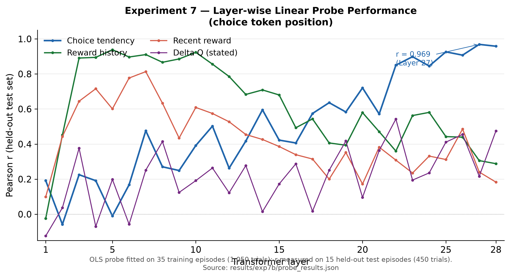
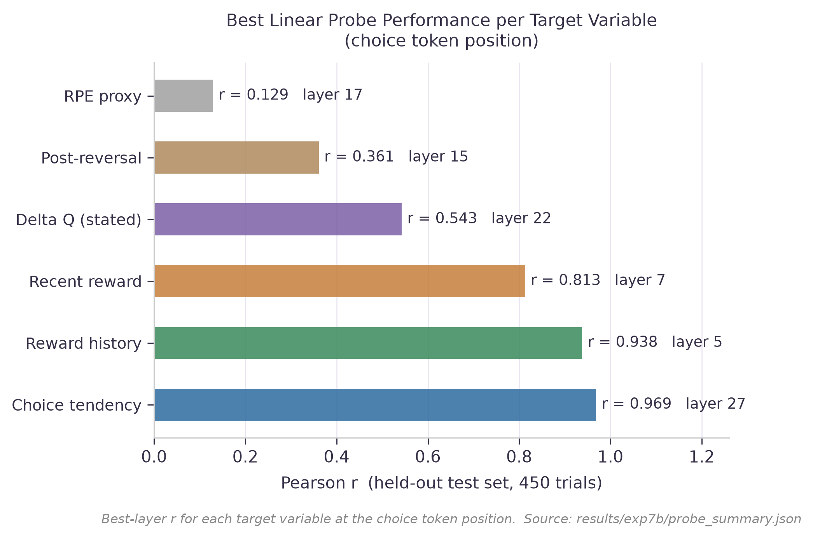
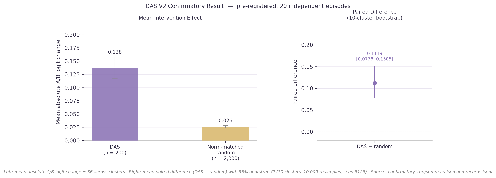
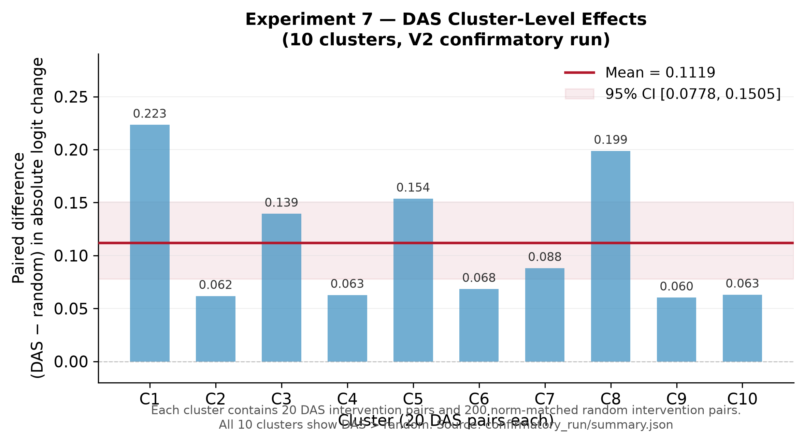
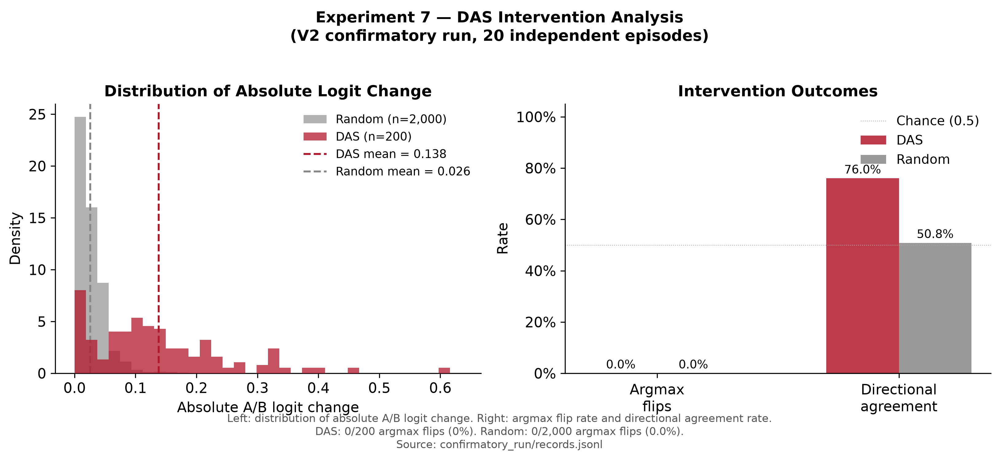

# Experiment 7 — Internal Representations and Causal Interventions

This experiment investigates what decision-related information is encoded in the hidden activations of Qwen3-0.6B during a bandit task, and whether directly modifying those activations produces a predictable change in the model's output.

The experiment uses two complementary methods:

1. **Linear Probing** — tests whether specific variables can be decoded from hidden activations using a linear model.
2. **Distributed Alignment Search (DAS)** — tests whether interventions on a learned activation subspace produce a directional change in model output.

These address different questions. Linear probing is a test of decodability. DAS is a test of causal sensitivity.

---

## 1. Experimental Task

Qwen3-0.6B performs a two-armed reversal bandit task.

| Task component | Description |
|----------------|-------------|
| Options | A and B |
| Reward probabilities | 0.80 for the better option; 0.20 for the worse option |
| Reversal | The better option changes around trial 15 of each episode |
| Dataset | 50 episodes × 30 trials = 1,500 trials |
| Information available | Previous choices and reward outcomes |
| Information withheld | True reward probabilities and reversal timing |
| Model learning | No weight updates |

---

## 2. Linear Probing

### Research Question

Can a linear model predict decision-related variables from the hidden activations of Qwen3-0.6B?

If yes, that variable is **linearly decodable** from that layer. This tells us the information is present in the activations. It does not tell us the model uses it when choosing an action.

### Model

Qwen3-0.6B (28 transformer blocks; hidden size 1,024)

### Input

- Hidden activations from one transformer layer, extracted at the choice token position
- One activation vector per trial: shape (1,024,)
- A target variable for each trial — for example, the model's A−B logit difference

### Method

**Ordinary Least Squares (OLS) linear probe**

A linear weight vector W is fitted to predict a target variable y from hidden activations h:

```
ŷ = W · h
```

The language model remains frozen. Only W is estimated.

### Process

**Step 1 — Generate experimental data**

Run Qwen3-0.6B on the bandit task and collect trial histories, choices, and rewards for 1,500 trials across 50 episodes.

**Step 2 — Extract hidden activations**

Pass each trial's prompt through Qwen3-0.6B and record the hidden state at the choice token position for all 29 layer indices (embedding output + 28 block outputs).

**Step 3 — Construct the probing dataset**

For each (layer, target variable) pair, assemble:

- **X:** Hidden activation matrix, shape (1,500, 1,024)
- **y:** Target variable values, shape (1,500,)

**Step 4 — Split by episode**

Divide the 50 episodes into training and test sets at the episode level, so all 30 trials from one episode remain in the same set.

| Set | Episodes | Trials | Use |
|-----|----------|--------|-----|
| Training | 35 (randomly selected, seed=42) | 1,050 | Fit probe weights W |
| Test | 15 (held out, never seen during fitting) | 450 | Evaluate Pearson r |

No validation set is required: OLS has no hyperparameters.

**Step 5 — Train the probe**

Mean-centre X using the training-set mean. Fit W using `np.linalg.lstsq` — a single analytic solve with no gradient descent.

**Step 6 — Evaluate predictions**

Apply W to the 450 held-out test trials. Measure Pearson r between predicted and actual target values.

Repeat for all 29 layers and all target variables.

### Output

- One Pearson r value per (layer, target variable) combination
- Best layer and r for each target variable
- Full layer profile saved to `results/probing/probe_results.json`

### Key Findings

Source: `results/probing/probe_summary.json` — test set only (450 trials, 15 held-out episodes).

| Target variable | What it measures | Best layer | Pearson r |
|----------------|-----------------|------------|-----------|
| **Choice tendency** | Calibrated A−B logit margin | **27** | **0.969** |
| Reward history | Cumulative mean reward so far | 5 | 0.938 |
| Recent reward | Mean reward over last 3 trials | 7 | 0.813 |
| Delta Q (stated) | Model's stated Q(A) − Q(B) | 22 | 0.543 |
| Post-reversal | Binary: before / after arm swap | 15 | 0.361 |
| RPE proxy | Reward − Q(chosen) | 17 | 0.129 |

Layer 27 (the final transformer block output) encodes the model's upcoming choice tendency with r = 0.969 on held-out episodes. Earlier layers (5–7) encode reward history more strongly than choice tendency.

**Limitation:** Decodability does not establish that the model causally uses Layer 27 activations when selecting an action. This is a correlation result.

### Figures

**Layer-wise probe performance** — Pearson r by transformer layer for key target variables at the choice token position.


*([SVG](figures/E7_01_probe_layerwise.svg))*

**Best probe performance per target** — Highest r achieved across layers for each target variable.


*([SVG](figures/E7_02_probe_summary.svg))*

---

## 3. Distributed Alignment Search (DAS)

### Research Question

Does directly modifying a learned activation subspace produce a predictable, directional change in the model's output?

Linear probing identifies where information can be decoded. DAS tests whether that location is causally sensitive: if the activation is changed in the direction the probe associates with a different choice tendency, does the model's output shift in the expected direction?

### Model

Qwen3-0.6B (intervention applied at Layer 27, the final transformer block output)

### Input

- Hidden activations from Layer 27, extracted for all 1,500 trials
- Pairs of trials: a **base** trial and a **source** trial with clearly different choice tendency values
- The linear probe direction W fitted during the probing experiment

### Method

**Distributed Alignment Search (DAS)**

DAS learns a 16-dimensional orthonormal subspace R (shape: 1,024 × 16). An intervention replaces the component of the base activation that lies within R's subspace with the corresponding component from the source activation:

```
h_intervened = h_base + R · R^T · (h_source − h_base)
```

R is parameterised as the Q factor of a QR decomposition, ensuring exact orthonormality throughout training. The language model's weights remain frozen.

### Process

**Step 1 — Split the data**

Divide the 1,500-trial dataset by row index into training and internal validation sets.

| Set | Rows | Episodes | Use |
|-----|------|----------|-----|
| Training | 0–1,199 | seq_0000–seq_0039 | Fit R |
| Internal validation | 1,200–1,499 | seq_0040–seq_0049 | Select best R checkpoint |
| Confirmatory test (V2) | 600 trials from 20 new episodes | Never used in any prior step | Measure causal effect |

The training and internal validation sets have zero episode overlap, verified by automated test.

**Step 2 — Construct intervention pairs**

Sample base and source trials with clearly different choice tendency values: 2,000 pairs for training, 500 pairs for internal validation.

**Step 3 — Train the subspace R**

For each base/source pair, apply the DAS intervention formula. Compute the signed probe-score shift:

```
shift = sign(v_source − v_base) × (probe_score(h_intervened) − probe_score(h_base))
```

Train R to maximise the fraction of pairs where this shift is positive (directional agreement).

**Step 4 — Select the best checkpoint**

Save the R matrix that achieves the highest directional agreement on the internal validation set.

**Step 5 — Freeze the subspace**

Lock the trained R matrix before the confirmatory experiment. Saved to `results/das/R_choice_tendency_L27_k16.npy`.

**Step 6 — Pre-register the confirmatory protocol**

Document the exact evaluation procedure in `validation/FINAL_PROTOCOL.md` before collecting new data. Record artifact hashes in `validation/REPRODUCIBILITY_MANIFEST.json`.

**Step 7 — Run the V2 confirmatory experiment**

Collect 20 entirely new episodes. Apply the frozen R at Layer 27 using a replacement hook. Compare each DAS intervention against 10 norm-matched random subspaces. Evaluate using a 10-cluster bootstrap (10,000 resamples, seed 8128).

### Output

- Frozen intervention subspace: `results/das/R_choice_tendency_L27_k16.npy`, shape (1,024, 16)
- DAS training metrics: `results/das/das_results.json`
- V2 confirmatory results: `results/validation/VALIDATION_RESULTS.md` and `results/validation/summary.json`

### Key Findings

Source: `results/validation/summary.json` and `results/validation/VALIDATION_RESULTS.md` — confirmatory V2 run, 20 new episodes, pre-registered protocol.

**Primary result** (pre-specified outcome):

| Measure | DAS | Norm-matched random |
|---------|-----|---------------------|
| Mean absolute A/B logit change | 0.138 | 0.026 |
| Paired difference (DAS − random) | 0.112 | — |
| 95% bootstrap CI | [0.078, 0.151] | — |
| Clusters with positive difference | 10 / 10 | — |

**Secondary results** (exploratory, not pre-specified):

| Measure | DAS | Random |
|---------|-----|--------|
| Directional agreement | 76.0% (152 / 200) | 50.85% (1,017 / 2,000) |
| A/B argmax flips | 0 / 200 | 0 / 2,000 |
| Calibrated threshold crossings | 1 / 200 | 7 / 2,000 |

The trained 16-dimensional subspace at Layer 27 produced significantly larger and more directionally consistent logit changes than norm-matched random subspaces, evaluated on entirely new episodes under a pre-registered protocol.

**Limitation:** Zero out of 200 interventions changed which arm had the higher logit. The model carries a persistent A-token bias from pretraining that the intervention norm cannot overcome. This result supports a causal effect on the measured output quantity, not a claim of behavioural control.

### Figures

**V2 primary result** — Mean absolute logit change and paired difference (DAS − random) with 95% bootstrap CI.


*([SVG](figures/E7_03_das_primary_result.svg))*

**Cluster-level effects** — Paired difference per cluster; all 10 clusters show DAS > random.


*([SVG](figures/E7_04_das_cluster_effects.svg))*

**Intervention distribution and outcomes** — Distribution of absolute logit change and intervention outcome rates.


*([SVG](figures/E7_05_das_intervention_dist.svg))*

---

## 4. Scope and Limitations

**No choice flip occurred.**
Zero DAS interventions changed the A/B argmax. The model's persistent letter-token prior prevents argmax flips at the intervention norm used.

**Probe r = 0.969 is not proof of a causal mechanism.**
It shows that Layer 27 activations predict choice tendency. It does not show that Layer 27 causes the choice.

**DAS sensitivity does not imply DAS necessity.**
The result shows that the 16-dimensional subspace responds causally. It does not show that this subspace is the sole or necessary mediator of the model's decisions.

**The model's decision algorithm is not identified.**
Behaviour is equally consistent with Rescorla-Wagner and Recency models (ΔBIC = 0.05). The two cannot be distinguished from behavioural data alone.

---

## 5. Repository Structure

```
Experiment_7/
├── README.md
├── requirements.txt
│
├── src/
│   ├── exp7_neuro.py         # linear probing and behaviour models
│   ├── exp7h_das.py          # DAS training
│   └── exp7d_dynamics.py     # activation perturbation dynamics
│
├── validation/
│   ├── FINAL_PROTOCOL.md     # pre-registered protocol (frozen before V2 run)
│   ├── REPRODUCIBILITY_MANIFEST.json
│   ├── README.md
│   └── scripts/
│       ├── confirm_v2.py     # V2 confirmatory experiment
│       ├── core.py           # metric definitions
│       └── model_adapter.py  # model loading utility
│
├── results/
│   ├── probing/
│   │   ├── probe_summary.json        # best layer and r per variable
│   │   └── probe_results.json        # full 29-layer profile
│   ├── das/
│   │   ├── R_choice_tendency_L27_k16.npy  # frozen DAS subspace
│   │   └── das_results.json               # training metrics
│   └── validation/
│       ├── VALIDATION_RESULTS.md     # V2 results summary
│       └── summary.json              # machine-readable V2 metrics
│
├── tests/
│   └── test_das_split_integrity.py   # 25 automated tests
│
└── docs/
    ├── SCIENTIFIC_SIGNOFF.md
    ├── SUPERVISOR_BRIEF.md
    └── CODEBASE_MAP.md
```

---

## 6. How to Run

### Setup

```bash
pip install -r requirements.txt
```

### Verify saved results (no model required)

```bash
python -m pytest tests/test_das_split_integrity.py -v
```

25 tests verify split integrity, R matrix orthonormality, and V2 result ranges. These run without activation files or the live model.

### Re-run linear probing from saved activations (no model required)

Requires activation files (~180 MB each, not included in this repository).

```bash
python src/exp7_neuro.py probe_7b
```

### Re-run DAS training from saved activations (no model required)

```bash
python src/exp7h_das.py train --only_vars choice_tendency --only_layers 27 --only_k 16
```

### Re-run the V2 confirmatory experiment (requires Qwen3-0.6B)

```bash
# Preflight check
python validation/scripts/confirm_v2.py --mode preflight

# Full confirmatory run (~14 minutes on Apple MPS)
python validation/scripts/confirm_v2.py --mode final
```

The confirmatory script will refuse to overwrite the existing results directory. The existing directory contains the original pre-registered results.

---

## 7. Reproducibility

| Component | Model required | Activation files required | Included |
|-----------|---------------|--------------------------|---------|
| Verify probe_summary.json | No | No | Yes |
| Verify V2 summary.json | No | No | Yes |
| Run 25 automated tests | No | No | Yes |
| Re-run linear probing | No | Yes (~180 MB each) | No |
| Re-run DAS training | No | Yes (~180 MB each) | No |
| Re-run V2 confirmatory | Yes | No | Requires model |

**Activation files** (`acts_choice.npy`, etc.) are not included. The model must be downloaded from HuggingFace: `Qwen/Qwen3-0.6B`, revision `c1899de289a04d12100db370d81485cdf75e47ca`.

---

## 8. Metric Terminology

The key `iia_val` in `results/das/das_results.json` measures **directional agreement (DA)**: the fraction of held-out pairs where the probe score shifted in the correct direction after the DAS intervention. This is not standard Interchange Intervention Accuracy (IIA) as defined in causal representation learning, which requires specifying a complete high-level causal model. The term directional agreement is used throughout to avoid this ambiguity.
