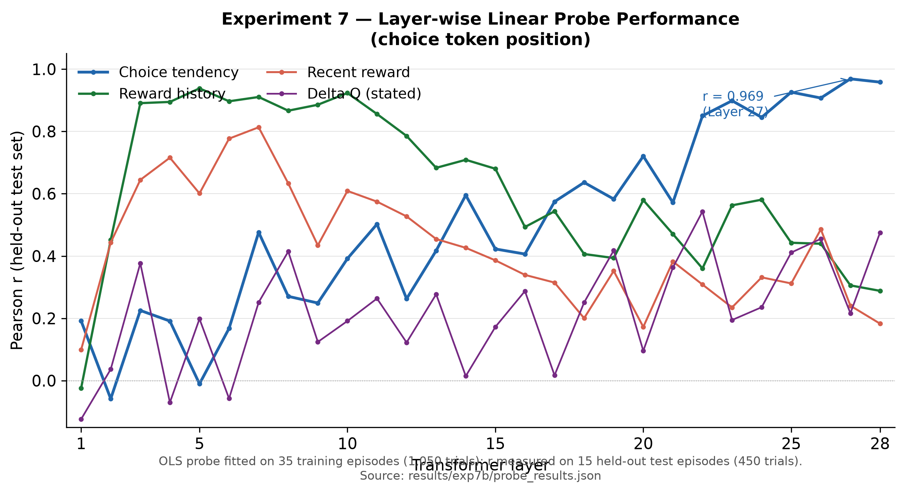
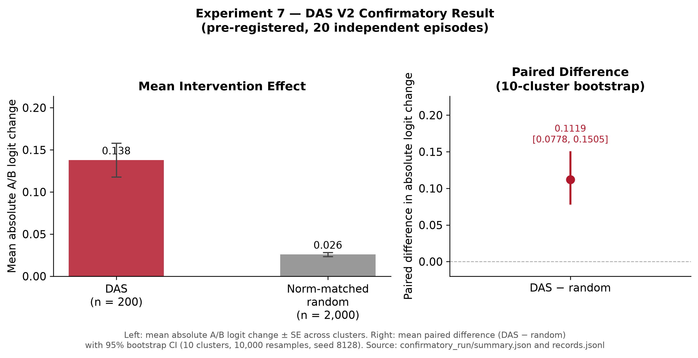

# Investigating Decision-Making in Large Language Models

This repository investigates how large language models (LLMs) process reward information, represent decision-related variables, and make choices in sequential decision-making tasks.

The experiments use Qwen3 models in a two-armed reversal bandit task. Model weights remain frozen throughout the experiments. Any adaptation must therefore occur through the information provided in the prompt rather than through parameter updates.

The research focuses on three questions:

1. **Behaviour:** Can an LLM use previous rewards to adapt its decisions?
2. **Representation:** What decision-related information can be identified in its internal activations?
3. **Causality:** Does intervening on these representations change the model's output?

---

## 1. Experimental Task

The experiments use a two-armed reversal bandit.

At each trial, the model chooses between two options, A and B, and receives a reward outcome.

| Task component | Description |
|----------------|-------------|
| Options | A and B |
| Reward probabilities | 0.80 for the better option; 0.20 for the worse option |
| Reversal | The better option changes during the episode |
| Information available | Previous choices and reward outcomes |
| Information withheld | True reward probabilities and reversal timing |
| Model learning | No weight updates; decisions depend on the provided history |

The task allows us to investigate whether the model uses reward history to adjust its choices when the environment changes.

---

## 2. Experiment 5 — Reflexion-Assisted Sequential Bandit

[View Experiment 5](Experiment_5/README.md)

### Objective

Can verbal self-reflection help an LLM learn from previous rewards and improve its decisions?

This experiment examines whether giving the model access to its own reflections on previous trials improves its ability to adapt when reward contingencies reverse.

### Models

- Qwen3-0.6B
- Qwen3-1.7B

### Input

The model receives:

- The two available choices, A and B.
- A history of previous choices and rewards.
- Previous verbal reflections, when the reflection condition is enabled.

### Method

**Reflexion-assisted sequential decision-making**

The experiment compares decision-making with and without an additional verbal reflection process.

### Process

**Step 1 — Present the task**

The model receives the current trial and the available decision history.

**Step 2 — Make a choice**

The model selects A or B.

**Step 3 — Provide feedback**

The selected choice and its reward outcome are recorded.

**Step 4 — Generate a reflection**

In the reflection condition, the model produces a verbal assessment of its previous decisions and outcomes.

**Step 5 — Update the prompt history**

The next trial includes the relevant history and, where applicable, previous reflections.

**Step 6 — Evaluate behaviour**

The resulting choice sequence is analysed to determine whether the model adapts to reward changes.

### Output

- Trial-by-trial choices and rewards.
- Model-generated reflections.
- Behavioural summaries.
- Measures of adaptation to reward reversal.

### Key Finding

Neither model passed the reversal-learning criterion in the reported experiments.

The reflection condition also produced a self-reinforcing preference for B in the observed runs.

**Interpretation:** Generating verbal reflections does not necessarily translate into better reward-sensitive decisions.

---

## 3. Experiment 7 — Internal Representations and Causal Interventions

[View Experiment 7](Experiment_7/README.md)

### Objective

What information about reward history and decision-making is represented inside Qwen3-0.6B, and does manipulating these representations affect its output?

Experiment 7 uses two complementary methods:

1. **Linear Probing** — tests whether specific information can be decoded from hidden activations.
2. **Distributed Alignment Search (DAS)** — tests whether interventions on learned activation subspaces affect the model's output.

### Model

Qwen3-0.6B

---

### 3.1 Linear Probing

#### Research Question

Can we predict decision-related variables from the model's hidden activations?

#### Input

- Trial histories from the bandit task.
- Hidden activations extracted from different model layers.
- Target variables describing reward history or decision-related behaviour.

#### Method

**Linear probing**

A simple linear model is trained to predict a target variable from the model's hidden activations.

The language model itself remains frozen.

#### Process

**Step 1 — Generate experimental data**

Run the bandit task and collect trial histories and relevant behavioural variables.

**Step 2 — Extract hidden activations**

Pass the experimental prompts through Qwen3-0.6B and record activations at selected layers and token positions.

**Step 3 — Construct the probing dataset**

Create:

- **X:** Hidden activation vectors.
- **y:** The target variable to be predicted.

**Step 4 — Split the dataset**

Separate episodes into training and test sets.

The probe is fitted using training data and evaluated on held-out episodes.

**Step 5 — Train the probe**

Fit a linear mapping from hidden activations to the target variable.

**Step 6 — Evaluate the predictions**

Compare predicted and actual target values to determine how accurately the variable can be decoded at each layer.

#### Output

- Trained linear probes.
- Predicted target values.
- Layer-wise decoding performance.
- Correlations between predictions and target values.

#### Key Findings

| Target variable | Layer | Correlation |
|----------------|-------|-------------|
| Choice tendency | 27 | r = 0.969 |
| Reward history | 5 | r = 0.938 |
| Recent reward | 7 | r = 0.813 |

These findings show that information associated with different aspects of the task can be decoded from different layers.

**Limitation:** Decodability does not establish that the model causally uses the decoded information when choosing an action.

---

### 3.2 Distributed Alignment Search (DAS)

#### Research Question

Does intervening on a learned decision-related representation change the model's output?

Linear probing tells us whether information can be decoded.

DAS investigates whether manipulating a learned activation subspace produces a predictable change in model output.

#### Input

- Hidden activations from Qwen3-0.6B.
- Base and source examples.
- A target intervention objective.
- A selected intervention layer.

#### Method

**Distributed Alignment Search (DAS)**

DAS learns a low-dimensional subspace of the model's activations and uses it to construct targeted interventions.

The language model's weights remain frozen.

#### Process

**Step 1 — Construct intervention examples**

Prepare base and source examples for the bandit task.

**Step 2 — Extract activations**

Collect the hidden activations required for the intervention.

**Step 3 — Learn the intervention subspace**

Train DAS parameters to identify a subspace associated with the target intervention objective.

**Step 4 — Apply the intervention**

Modify the base example's hidden activation using information from the source example.

**Step 5 — Continue the forward pass**

Observe how the intervention affects the model's output.

**Step 6 — Evaluate intervention effects**

Compare intervened and non-intervened outputs, including appropriate controls.

**Step 7 — Independent verification**

Evaluate the intervention using a separate confirmatory dataset.

#### Output

- A learned intervention subspace.
- Changes in output logits.
- Directional intervention metrics.
- Control comparisons.
- Independent validation results.

#### Key Findings

A 16-dimensional DAS subspace at Layer 27 produced measurable directional effects on the model's output.

The independent V2 verification reported:

| Metric | Result |
|--------|--------|
| Paired intervention difference | 0.1119 |
| 95% confidence interval | [0.0778, 0.1505] |
| A/B argmax flips | 0 / 200 |

**Interpretation:** The intervention affected the model's output scores, but did not change the A/B argmax choice in the reported confirmatory evaluation.

This supports a causal effect on the measured output quantity, not a claim of successful behavioural control.

---

## 4. Selected Results

**Layer-wise linear probe performance** (Experiment 7) — Pearson r between hidden activations and target variables across transformer layers.



**DAS V2 confirmatory result** (Experiment 7) — Mean absolute logit change and paired difference with 95% bootstrap CI, evaluated on 20 independent episodes.



For full figure sets see [Experiment 5 figures](Experiment_5/README.md#figures) and [Experiment 7 figures](Experiment_7/README.md#figures).

---

## 6. How the Experiments Connect

The experiments investigate different stages of the decision-making problem.

| Stage | Question | Experiment | Method |
|-------|----------|------------|--------|
| Behaviour | Does the model adapt its choices based on rewards? | Experiment 5 | Sequential bandit and verbal reflection |
| Representation | Can decision-related information be decoded from hidden states? | Experiment 7 | Linear probing |
| Intervention | Does manipulating a learned representation affect output scores? | Experiment 7 | DAS |

The overall research progression is:

**Behavioural evaluation → Representation analysis → Causal intervention**

Each stage addresses a different question.

A model may represent reward-related information without using it effectively to make adaptive choices. Similarly, an intervention may change output scores without changing the final selected action.

---

## 7. Repository Structure

```
llm_experiment/
├── README.md
├── .gitignore
│
├── Experiment_5/
│   ├── README.md
│   ├── exp5_sequential_reflexion.py
│   ├── sequential_bandit_rpe.py
│   ├── causal_rpe_bandit.py
│   ├── Qwen3_0.6B/
│   └── Qwen3_1.7B_20x20/
│
└── Experiment_7/
    ├── README.md
    ├── requirements.txt
    ├── src/
    ├── validation/
    ├── results/
    ├── tests/
    └── docs/
```

For implementation details, experiment configurations, evaluation procedures, and reproducibility instructions, see the README within each experiment directory.

---

## 8. Scope and Limitations

- All experiments investigate inference-time behaviour with frozen model weights.
- Linear probing identifies decodable information, not necessarily information used causally in decision-making.
- DAS identifies intervention-sensitive representations under a specific experimental protocol.
- The reported DAS intervention did not produce A/B argmax flips in the independent V2 evaluation.
- These findings do not establish that the models implement human reinforcement-learning mechanisms or biological reward-processing systems.
